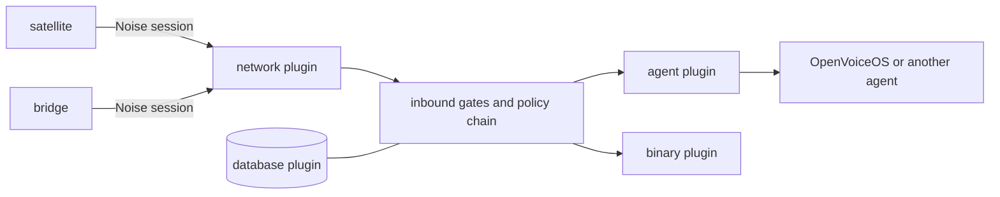

# HiveMind-core documentation
<!-- agent-hint
covers: the reading order of the docs and one line for each page
source: docs/
generated: no
verify: diff <(ls docs/*.md | grep -v index.md | xargs -n1 basename | sort) <(grep -o '([a-z0-9-]*\.md)' docs/index.md | tr -d '()' | sort -u)
see: ../README.md
-->

HiveMind-core is the hub of a HiveMind network: it authenticates satellites with a Noise handshake, checks each message against a policy chain, and passes the messages to an agent such as OpenVoiceOS.



## Quickstart

```bash
uv pip install --prerelease=allow hivemind-core
hivemind-core add-client --name kitchen --allow ovos.utterance.handle --allow recognizer_loop:utterance
hivemind-core listen
```

`add-client` prints the access key and the password for the satellite. `listen` starts the hub on the WebSocket port 5678. [Install and run a hub](install-and-run.md) shows the output of each step.

## Pages

| Page | What you get there |
| :--- | :--- |
| [Install and run a hub](install-and-run.md) | install, first client, start the hub, the files that it writes |
| [Add and manage clients](clients.md) | the `hivemind-core` CLI: add, list, permissions, reset the Noise pin, remove |
| [Configuration reference](configuration.md) | each key of `server.json` with its default |
| [Security model](security.md) | access keys, the Noise handshake, the key pin, the rate limit, the inbound gates |
| [Policies and ACLs](policies.md) | the message type whitelist, the policy chain and the deny reply |
| [Plugins](plugins.md) | network, agent, binary and database plugins |
| [Troubleshooting](troubleshooting.md) | log messages and replies, with the cause and the fix |
| [Contributing and tests](contributing.md) | development setup, tests, CI and licence |
