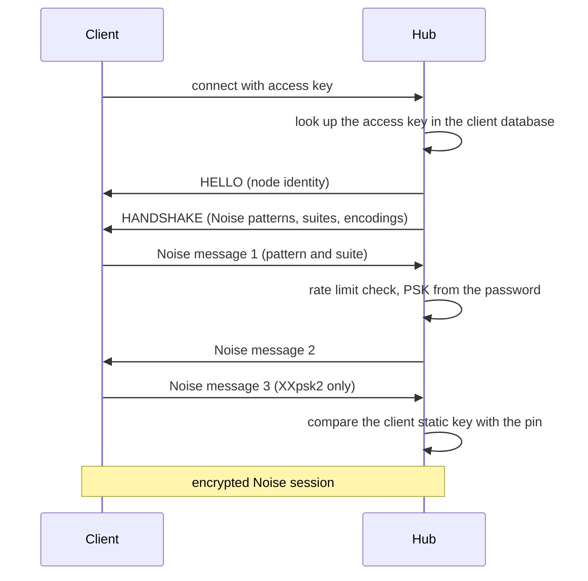
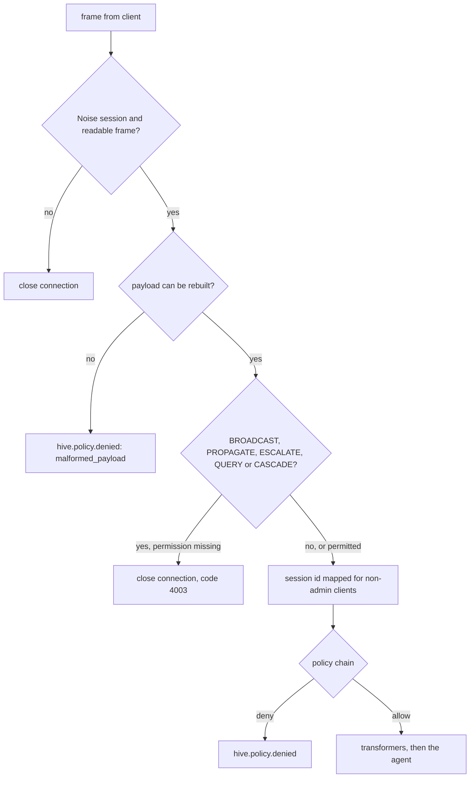

# Security model
<!-- agent-hint
covers: how the hub authenticates a client and encrypts the session (Noise XXpsk2/KKpsk0), the key pin, the handshake rate limit and the inbound gates
source: hivemind_core/protocol.py:handle_new_client, hivemind_core/protocol.py:handle_noise_handshake_message, hivemind_core/protocol.py:HandshakeFailureLimiter, hivemind_core/protocol.py:handle_message, hivemind_core/policy.py
generated: no
verify: python3 -c "import sys; from hivemind_bus_client.noise import NOISE_PATTERNS, NOISE_SUITES; doc=open('docs/security.md').read(); sys.exit(0 if all(x in doc for x in NOISE_PATTERNS+NOISE_SUITES) else 1)"
see: policies.md
-->

This page explains how the hub decides who can connect and what a connected client can send. Read it before you put a hub on a network that you do not control.

## Example

A client that connects with a known access key and the correct password gets an encrypted session. The hub log shows the handshake. With a wrong password, the handshake fails on the client side, and the hub counts a failed handshake.



## The layers

### Access key and password

Each client has an access key and a password in the client database (see [Clients](clients.md)). The access key names the client. The hub refuses an unknown access key before any handshake. The password is the shared secret. It never travels on the wire: both sides derive a 32-byte pre-shared key (PSK) from it with argon2id, salted with SHA-256 of the hub node identity.

The hub refuses a guessable password at `add-client` (`min_password_bits`, default 40). It checks again at each handshake, unless `runtime_password_strength_check` is `false` or `HIVEMIND_DISABLE_PASSWORD_STRENGTH_CHECK=1` is set.

### Noise handshake

The Noise handshake is the only key exchange. A connection that cannot do it gets close code 1008 with the reason `this node requires protocol v3 (the Noise handshake)`. The hub offers two patterns and two suites:

| Pattern | When the hub offers it |
| :--- | :--- |
| `XXpsk2` | always |
| `KKpsk0` | only when the hub has a pinned static key for this client |

| Suite |
| :--- |
| `25519_ChaChaPoly_SHA256` |
| `25519_AESGCM_SHA256` |

The client is the Noise initiator and picks one pattern and one suite from the offer. A pattern or a suite that the hub did not offer fails the handshake. The Noise prologue binds the HELLO and HANDSHAKE payloads, so a change to the offer on the wire fails the handshake. A wrong password gives a wrong PSK, and the handshake fails.

After the handshake, the Noise cipher states encrypt each frame. A frame in clear text that is not HELLO or HANDSHAKE closes the connection. The `ssl` option of a transport adds TLS on the socket. TLS does not replace the Noise session, and the hub does not need it.

### Static key pin

On the first XXpsk2 handshake of a client, the hub records the Noise static public key of that client in its database row (`noise_pubkey` in the metadata). This is trust on first use. Each later handshake must present the same key. When the key is different, the hub stops the handshake and logs this text:

```text
client Noise static key contradicts the pinned key. If this client was reinstalled or moved to new hardware, clear the pin with 'hivemind-core reset-noise-pin <id>' and let it pair again; otherwise another node is answering for it
```

Run `reset-noise-pin` only when you know that the client changed. The pin is the check that stops a second device that has the credentials of the client.

### Handshake rate limit

The rate limit is a defence against password guesses. The hub counts failed handshakes for each access key and for each source IP inside a sliding window. When a count reaches its limit, the hub refuses the next handshake from that key or that IP before it sends Noise message 2. The refusal lasts until the oldest failure leaves the window. A successful handshake does not reset a count.

| Key | Default |
| :--- | :--- |
| `handshake_failures_per_key` | `5` |
| `handshake_failures_per_ip` | `20` |
| `handshake_failure_window` | `60` seconds |

A value of `0` turns that limit off. The hub keeps the counts in memory, so a restart clears them.

## Inbound gates

Each frame from a connected client passes these gates in this order. A frame that fails a gate goes no further.



1. **Session and frame.** A frame that the hub cannot read before the Noise session exists, or a frame in clear text, closes the connection.
2. **Payload shape.** A wrapper message that does not hold a valid nested message gets a `hive.policy.denied` reply with code `malformed_payload`. The connection stays open.
3. **Wrapper permissions.** The hub reads the permissions of the client from the database again, at most 5 seconds old. BROADCAST needs `is_admin` and `can_broadcast`. PROPAGATE and CASCADE need `can_propagate`. ESCALATE and QUERY need `can_escalate`. A client that sends a wrapper without the permission is disconnected with close code 4003.
4. **Session mapping.** The hub maps the session id of a non-admin client into a namespace of that connection, so one client cannot write to the session of another or to the `default` session.
5. **Policy chain.** `MessageTypeACLPolicy`, then `DefaultSessionPolicy`, then the configured policies. A deny gets a `hive.policy.denied` reply. [Policies and ACLs](policies.md) explains the chain.

When the policy chain allows a message, the transformers run and the hub sends the message to the agent. When the agent bus is not available, the client gets a `hive.policy.denied` reply with code `backend_unavailable`, and the message is lost.

---
[← Configuration](configuration.md) · [Home](index.md) · [Policies and ACLs →](policies.md)
